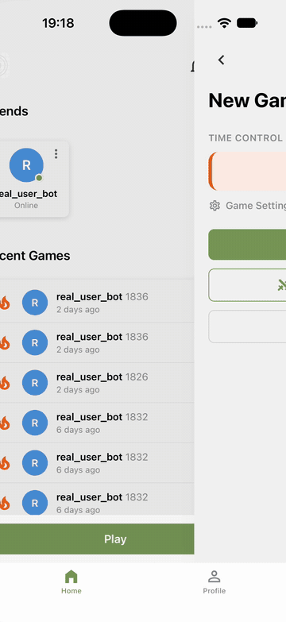
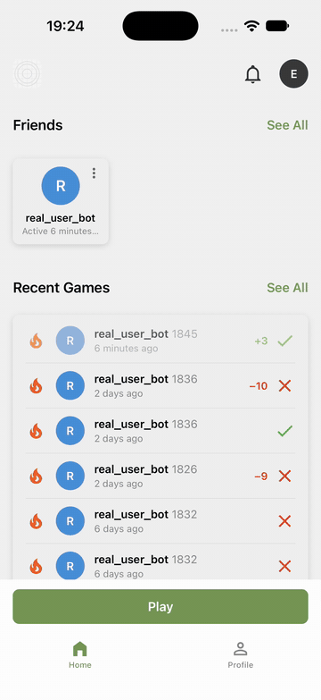

# cChess

A chess app for iOS (more to come), built with React Native and Expo.
Pieces move either by tap (tap a piece, then tap a destination square) or
by drag-and-drop; all rules enforcement (legal moves, check/checkmate/
stalemate, castling, en passant, promotion) is delegated to
[chess.js](https://github.com/jhlywa/chess.js).

## Demo

<table>
  <tr>
    <td align="center" width="50%">
      
    </td>
    <td align="center" width="50%">
      
    </td>
  </tr>
  <tr>
    <td align="center">
      Online play: matchmaking, drag-and-drop moves, checkmate
    </td>
    <td align="center">
      Reviewing a finished game, then rating history and stats
    </td>
  </tr>
</table>

## Features

WIP (TBD)

## Tech stack

- [Expo](https://expo.dev) SDK 58 / React Native 0.88 / React 19
- TypeScript
- [chess.js](https://github.com/jhlywa/chess.js) - chess rules engine
- React Navigation (native-stack + bottom-tabs)
- [socket.io-client](https://socket.io/docs/v4/client-api/) /
  `expo-secure-store` - live connection to `cchess-be` and on-device
  guest-session token storage
- react-native-reanimated / react-native-gesture-handler - animation and
  gesture primitives
- Jest + [@testing-library/react-native](https://callstack.github.io/react-native-testing-library/) -
  unit and component tests
- [Maestro](https://maestro.mobile.dev) - end-to-end tests against a real
  iOS Simulator

## Project structure

```
src/
├── domain/                           Pure, framework-agnostic chess logic - no
│                                     React/RN imports, plain Jest-testable with no rendering
│   ├── ChessEngine.ts                Facade over chess.js: attemptMove, legal moves,
│   │                                 turn/check/game-over status
│   │
│   ├── castlingSquares.ts            Castling rook from/to squares
│   │
│   └── types.ts                      DomainPiece, AppliedMove, MoveResult, etc.
│
├── network/                          A second framework-agnostic layer - talking to
│   │                                 cchess-be (the Socket.IO/NestJS backend)
│   ├── env.ts                        SERVER_URL, defaulting to http://localhost:3000
│   ├── restClient.ts                 Guest-session REST calls
│   ├── socketClient.ts               The one AppSocket singleton (connect/disconnect/get)
│   ├── socketEvents.ts               Every client<->server event's payload types
│   └── tokenStorage.ts               expo-secure-store wrapper for the token pair
│
├── hooks/                            React state/animation/online-play layer
│   ├── useChessGame.ts               The single state machine for an in-progress game
│   │                                 (a reducer owning a ChessEngine instance)
│   │
│   ├── useAuthSessionBootstrap.ts    Guest session + socket bootstrap (backs AuthSessionContext)
│   │
│   ├── useMatchmaking.ts             Seek/cancel + game:created, for the Matchmaking screen
│   │
│   ├── useOnlineChessGame.ts         Drives an in-progress online game on top of useChessGame
│   │                                 (delegates server-push handling to useGameServerEvents)
│   │
│   └── ...                          useGameSnapshot, useGameClock, useConnectionLatency,
│                                     usePopoverMenu, useToast, useBottomSheet, etc.
│
├── context/                           Every React context, one top-level directory
│   ├── ChessGameContext.tsx          Scoped Context (not global state) delivering
│   │                                 useChessGame's state/handlers down to GameBoard
│   ├── AuthSessionContext.tsx        The one genuinely app-wide context - guest
│   │                                 session + socket connection, mounted in App.tsx
│   └── LiveGame/
│       └── OnlineChessGameContext.tsx   The online counterpart, backed by useOnlineChessGame
│
├── components/                       Presentational only - consumes the hooks/context above
│   ├── Board/                        The app's boards - the only code that uses
│   │                                 lib/chessboard: GameBoard (a game, from
│   │                                 ChessGameContext), PositionBoard (a FEN, read-only),
│   │                                 EmptyBoard, SetupBoard (the position editor)
│   │
│   ├── GameHeader/, GameToolbar/,    In-game UI - header, toolbar, move list, player
│   │   MoveList/, PlayerBar/,        bars with captured pieces, clocks, result card,
│   │   CapturedPieces/, GameClock/,  chat, result/piece icons, connection strength,
│   │   GameOverCard/, ChatSheet/,    promotion picker
│   │   GameResultIcon/,
│   │   GameTypeIcon/,
│   │   ConnectionStrengthIndicator/,
│   │   PromotionMenu/
│   │
│   ├── FriendsCarousel/, FriendRow/, Friends, requests, challenges, a player's
│   │   FriendRequestCard/,           activity, direct messages
│   │   ChallengeCard/,
│   │   NotificationsMenu/,
│   │   UserSearchField/,
│   │   ChallengeSheet/,
│   │   ActivityList/, MessageList/
│   │
│   ├── Button/, CircleIconButton/,   Shared presentational primitives reused
│   │   BottomSheet/, Popover/,       across more than one screen
│   │   PopoverMenu/, SectionHeader/,
│   │   Avatar/, ActionList/, SegmentedTabs/, EmptyState/,
│   │   Toast/, TimeControlSelector/
│   │
│   └── HomeHeader/,                  Home-screen-specific pieces
│       RecentGamesList/
│
├── screens/
│   ├── Home/, HomeStack/,            App.tsx -> HomeStack (HomeTabs, LiveGame,
│   │   HomeTabs/, HomeTabStack/,     GameViewer, UserProfile, Conversation,
│   │   Profile/                      GamesList, RatingStats, SignIn,
│   │                                 CreateAccount) -> HomeTabs (bottom tabs:
│   │                                 HomeTabStack, Profile) -> HomeTabStack
│   │                                 (Home, NewGame, Friends)
│   │
│   ├── NewGame/                      Time control and game settings; opens LiveGame
│   │
│   ├── LiveGame/                     The server-driven online game screen: seeks an
│   │                                 opponent, then plays the matched game in place
│   │
│   ├── GameViewer/                   Steps through a finished game, or watches one
│   │                                 in progress
│   │
│   └── Friends/, UserProfile/,       Friends and requests, a player's profile, a
│       Conversation/, GamesList/,    conversation, a full game history, and a
│       RatingStats/                  player's rating and results in a category
│
├── theme/                            The style guide: spacing, radius, type and shadow
│                                     scales, light and dark colors, board themes, and
│                                     makeStyles for a component's themed StyleSheet
│
├── constants/                        Board size, piece image lookups,
│                                     time controls, error-message fallbacks
│
├── lib/chessboard/                   The chessboard, written as a package of its own: draws
│                                     a FEN and moves pieces by tap or drag where it's told
│                                     they may go - no chess rules, nothing of the app's
│                                     (ESLint keeps it that way); only components/Board/ uses it
│
└── testUtils/                        Jest/RNTL helpers: gesture simulation, Animated value
                                      reads, a text board visualizer, a fake AppSocket,
                                      a GameSnapshot fixture builder, a safe-area wrapper
```

Business logic (chess rules, move legality, turn state, and now
online-game orchestration) is deliberately kept out of presentational
components - see `src/domain/`, `src/network/`, and `src/hooks/`. The board
itself is a separate library, `src/lib/chessboard/`, that knows no chess: the
app tells it the position and where pieces may go, and hears back the moves
made, through the adapter in `src/components/Board/` - so swapping in another
board library means changing that adapter alone. That separation
is what makes the rules and state machines unit-testable without rendering
anything, and keeps everything under `components/` purely presentational.

## Getting started

### Prerequisites

- **Node.js 22.16.0**, pinned in `.nvmrc` - run `nvm use` before anything
  else..
- The Expo CLI is a project dependency, invoked via `npx expo` /
  `npm run <script>` - no global install needed.
- A way to actually run the app: Xcode + an iOS Simulator.
- [Maestro](https://maestro.mobile.dev) installed separately
  (`curl -Ls "https://get.maestro.mobile.dev" | bash`), only if you want to
  run the end-to-end suite - see `.maestro/README.md`.
- A running `cchess-be` instance (the Socket.IO/NestJS backend) for guest
  auth, matchmaking, and live games to actually work - the app falls back
  to `http://localhost:3000` if `EXPO_PUBLIC_SERVER_URL` isn't set (see
  `.env.example`). Setting `EXPO_PUBLIC_DEBUG_DRAG=1` there logs every
  drag-and-drop to the Metro terminal - how the board judged the drop, and
  what the game made of it - for chasing drops that go astray on a device.

### Install

```bash
nvm use
npm install
```

### Run

```bash
npm start        # start the Metro bundler - press i, or scan the QR code with Expo Go
npm run ios      # start the bundler and open directly in the iOS Simulator
```

## Testing

Two deliberately separate layers:

|                    | Unit/component (Jest)                                                        | End-to-end (Maestro)                                |
| ------------------ | ---------------------------------------------------------------------------- | --------------------------------------------------- |
| Run with           | `npm test`                                                                   | `npm run test:e2e`                                  |
| Covers             | Chess rules, the game state machine, gesture→callback translation, rendering | Real native gestures driving the actual running app |
| Needs a simulator? | No                                                                           | Yes - a booted iOS Simulator + `expo start` running |

```bash
npm test                 # full Jest suite
npm test -- --watch      # watch mode
npm run test:e2e         # full Maestro suite - see .maestro/README.md for setup
```

Chess rules (legality, check/checkmate, castling, en passant, promotion)
are unit-tested directly against `ChessEngine` with no rendering involved -
see `src/domain/__tests__/`. `src/network/`'s pure infra (REST client,
socket client, token storage) is tested the same way, in
`src/network/__tests__/`. The gesture layer (tap/drag → the right move
being attempted) is tested by firing Gesture Handler's gestures from Jest -
see `src/lib/chessboard/` for the board on its own, and
`src/components/Board/GameBoard.spec.tsx` for it playing a real game. Neither
layer re-does the other's job: rules bugs belong in a `ChessEngine` test,
gesture-translation bugs belong in a board test, and "does this
actually work on a real device" questions belong in a Maestro flow.

## Development notes

- This is an Expo managed-workflow project - there are no native `ios/`/
  `android/` directories checked in; `expo prebuild` would generate them on
  demand if a bare workflow is ever needed.
- Every style comes from `src/theme/`: colors from the light or dark
  theme (ESLint refuses color literals anywhere else), and spacing,
  corners, type and shadows from its scales. Profile → Appearance picks
  System, Light or Dark, and the board's colors from
  `src/theme/boardThemes.ts`.
- The pieces are our own drawings, SVGs generated by
  `node scripts/generate-pieces.js` into the board library
  (`src/lib/chessboard/defaultPieceSet.ts`). The app's piece sets, by name,
  are in `src/constants/appearance.ts` and
  `src/components/Board/pieceSets.ts`: a new set is a new name there, ready
  for Appearance to offer once there's more than one.
