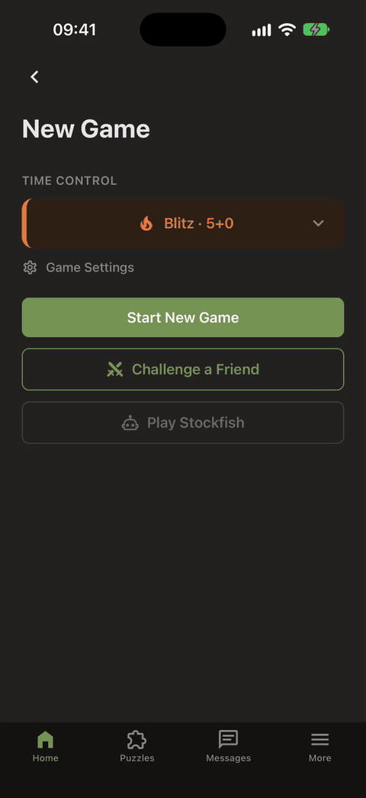
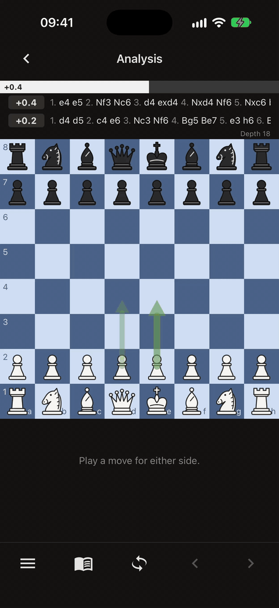
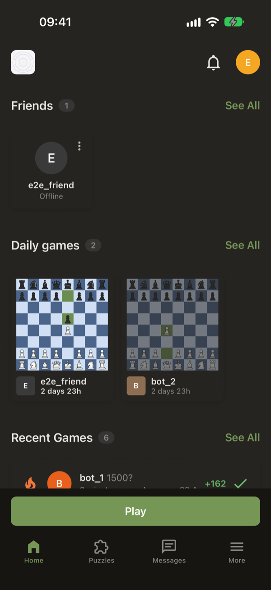
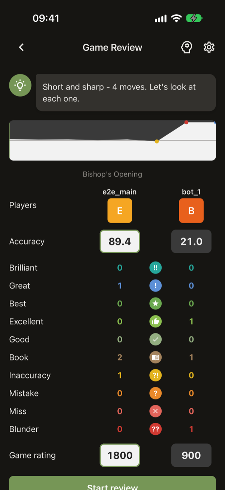
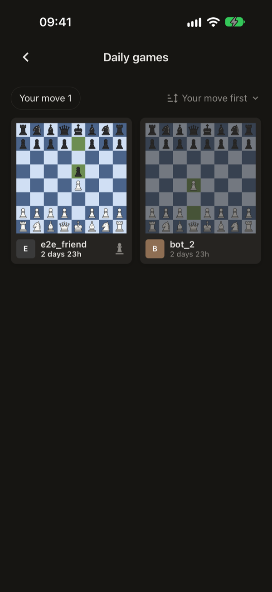
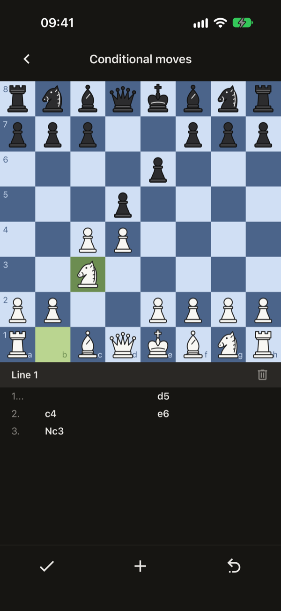
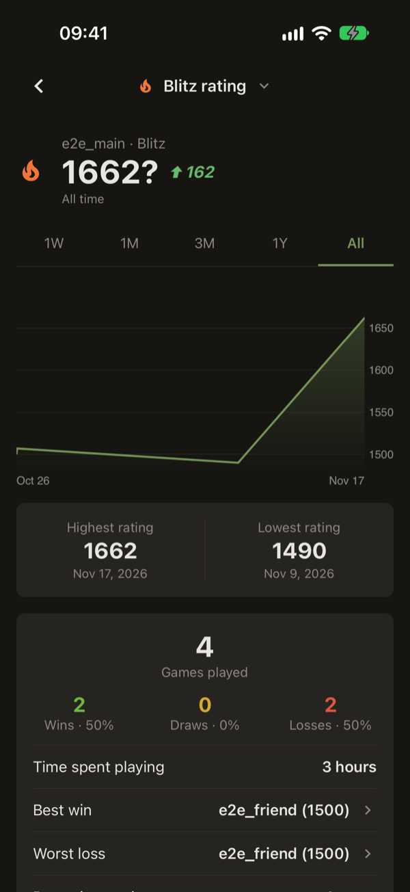
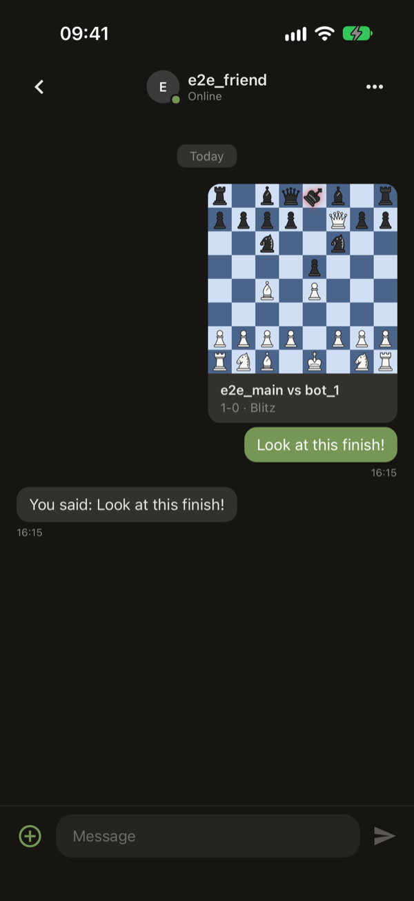
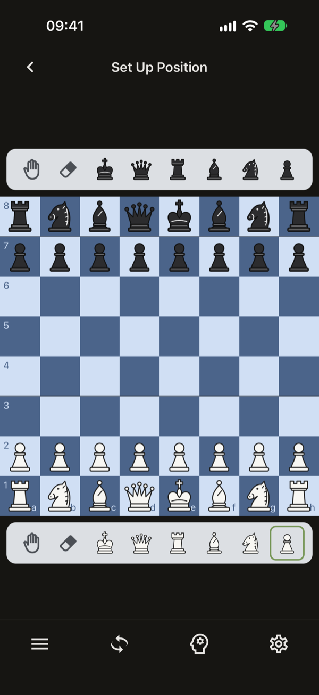
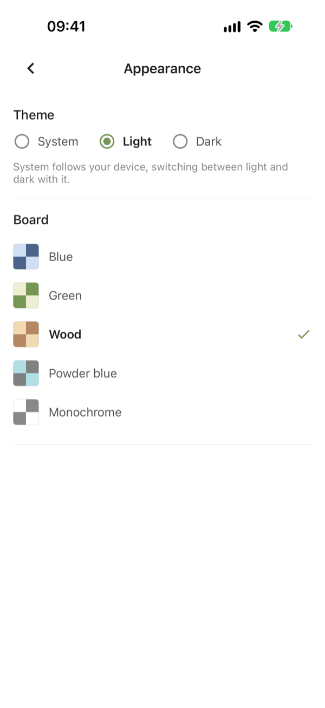

# cChess

[](https://github.com/chuxmykel/cchess/actions/workflows/lint.yml)
[](https://github.com/chuxmykel/cchess/actions/workflows/test.yml)
[](https://github.com/chuxmykel/cchess/actions/workflows/e2e.yml)


A chess app for iOS and Android. You can play live or daily games online,
review them with an on-device Stockfish coach, analyse any position, and
play with friends. It's built with React Native and Expo, and runs on its
own NestJS backend, [cchess-be](https://github.com/chuxmykel/cchess-be).

## Demo

<table>
  <tr>
    <td align="center" width="33%">
      
    </td>
    <td align="center" width="33%">
      
    </td>
    <td align="center" width="33%">
      
    </td>
  </tr>
  <tr>
    <td align="center"><b>Play</b><br />matchmaking, drag or tap, premoves</td>
    <td align="center"><b>Review</b><br />move classes, accuracy, a coach</td>
    <td align="center"><b>Analyse</b><br />Stockfish 19, variations, openings</td>
  </tr>
</table>

<details>
<summary><b>More screenshots</b></summary>
<br />
<table>
  <tr>
    <td align="center"><br />Home</td>
    <td align="center"><br />Review summary</td>
    <td align="center"><br />Daily games</td>
    <td align="center"><br />Conditional moves</td>
  </tr>
  <tr>
    <td align="center"><br />Rating stats</td>
    <td align="center"><br />Messages</td>
    <td align="center"><br />Position editor</td>
    <td align="center"><br />Light mode, board themes</td>
  </tr>
</table>
</details>

## Features

**Play**

- Live games from bullet to classical, rated or casual, with an
  opponent's rating range and a choice of color.
- Move by drag-and-drop or tap. Premoves are held by the server and
  played the instant the opponent's move lands.
- Draw offers, resign, abort, rematches with a running series score, and
  in-game chat.
- Reconnects pick up where you left off, and an interrupted game resumes
  when the app opens again.

**Daily games**

- 1 to 14 days a move, played alongside live games.
- Optional move confirmation, conditional moves, private notes, and an
  analysis board on the game as it stands.

**Game review**

- Every move classed from brilliant to blunder, accuracy for each side,
  and a game rating.
- A coach that explains each key moment in words, optionally read aloud.
  Show plays out the better line, Best shows the best move, and Retry
  lets you find it yourself.
- Stockfish runs on the device, and the server keeps each review so no
  game is analysed twice.

**Analysis**

- Stockfish 19 with up to three lines, arrows, threats and an eval bar.
- Variations you can promote or delete, and an opening name for every
  position.
- An opening explorer over lichess's Masters and Lichess databases, or any
  player's games here.
- Start from your games, a pasted PGN or FEN, or a position you set up.

**Friends**

- Friends with live presence, challenges, and watching a friend's game
  live.
- Direct messages with typing indicators, read receipts, and games or
  positions shared on a mini board.
- Profiles, game history with filters, and rating charts per category.

**Look and feel**

- Light and dark mode, five board themes, and the app's own SVG pieces.
- Sounds for moves, captures, checks and the end of a game, and
  board animations on the UI thread.

## Tech stack

- [Expo](https://expo.dev) SDK 58, React Native 0.88, React 19, TypeScript
- [chess.js](https://github.com/jhlywa/chess.js) for the rules, the same
  version as the server
- Reanimated and Gesture Handler for the board, react-native-svg for the
  pieces
- [Stockfish](https://stockfishchess.org) 19 (WASM) in a hidden
  `react-native-webview`, downloaded on first use rather than shipped
- React Navigation, socket.io-client, expo-secure-store
- victory-native on Skia for the rating charts, and expo-audio and
  expo-speech for sounds and the coach's voice
- Jest and React Native Testing Library, plus
  [Maestro](https://maestro.mobile.dev) for end-to-end tests on both
  platforms

## Getting started

Prerequisites:

- **Node 22.16.0**, pinned in `.nvmrc`
- Somewhere to run it: Xcode's iOS Simulator, an Android emulator
  (`.maestro/README.md` has a setup that needs no Android Studio), or a
  phone with Expo Go
- A running [cchess-be](https://github.com/chuxmykel/cchess-be). The app
  uses `http://localhost:3000` unless `EXPO_PUBLIC_SERVER_URL` says
  otherwise (see `.env.example`).

```bash
nvm use
npm install
npm start    # then press i (iOS Simulator) or a (Android emulator), or scan the QR code with Expo Go
```

## Testing

|          | Unit and component (Jest)                                   | End to end (Maestro)                                                     |
| -------- | ----------------------------------------------------------- | ------------------------------------------------------------------------ |
| Run with | `npm test`                                                  | `npm run test:e2e:ios` / `npm run test:e2e:android`                      |
| Covers   | Chess rules, game state machines, gestures, rendering       | Real gestures in the running app, against a real, seeded backend         |
| Runs on  | Both platforms: every test runs as iOS and again as Android | The iOS Simulator and the Android emulator                               |
| Needs    | Nothing                                                     | A simulator or emulator, plus Docker (or Postgres) and the sibling repos |

```bash
npm test                              # the full Jest suite, as iOS and as Android
npm test -- --selectProjects android  # one platform
npm run test:e2e:ios                  # the Maestro suite - see .maestro/README.md
npm run lint && npx tsc --noEmit      # lint and typecheck
```

The e2e script brings up everything it needs and takes it down again: the
backend seeded with test accounts, Metro, and scripted opponents.
`scripts/demo/record.sh` uses the same setup to record this README's GIFs
and screenshots.

## Architecture

```
domain/        pure chess logic: no React, plain Jest-testable
network/       REST and Socket.IO clients for cchess-be
engine/        Stockfish over UCI, its download and the review runner
theme/         the style guide: scales, light and dark colors
  -> hooks/       state machines and online-play orchestration
    -> context/     thin providers over those hooks
      -> components/  presentational only
        -> screens/     wiring and navigation

lib/chessboard/  the board, written as a package of its own
```

Each layer only knows about the ones below it. Rules, state machines and
networking can be unit-tested without rendering anything, and components
stay presentational. The board in `src/lib/chessboard/` knows no chess
rules and imports nothing from the app, and ESLint enforces that. It's
told the position and where pieces may go, and only
`src/components/Board/` talks to it, so the board could be swapped by
changing that one adapter.

[CLAUDE.md](CLAUDE.md) has the full tour, module by module, with the
project's conventions.

## Related repos

- [cchess-be](https://github.com/chuxmykel/cchess-be): the NestJS and
  Socket.IO server
- [cchess-infra](https://github.com/chuxmykel/cchess-infra): hosting it on
  one VPS with Docker Compose

## Credits and license

- [Stockfish](https://stockfishchess.org) (GPL-3.0) is downloaded by the
  app at runtime from its author's release, not shipped with it. Settings →
  Licenses says where its source is.
- Opening names come from lichess's
  [chess-openings](https://github.com/lichess-org/chess-openings) (CC0).
- The pieces and sounds are this project's own, generated by
  `scripts/generate-pieces.js` and `scripts/generate-sounds.js`.

No license has been chosen for this code yet, so all rights are reserved.
